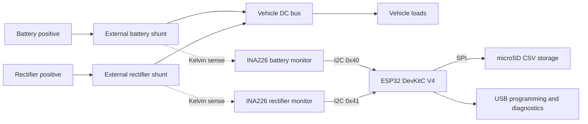

# Stage 1 — project audit and design specification

Status: design proposal and verified input audit; firmware, PCB and mechanical implementation belong to later stages.

## Project goal

Build a compact Formula SAE low-voltage DC power logger that measures the battery and rectifier independently, records voltage/current/power to microSD, and can be programmed over USB. Use straightforward C++17 on an ESP32. Provide Unity tests for every portable firmware module, an actual editable PCB design, manufacturing outputs, enclosure models, and an assembly/calibration guide.

Delivery is staged: finish one stage, report it, and wait for the user's instruction before the next. The user has also requested a second model to review the work. No purchase, fabrication, upload or deployment is authorized by this document.

## What exists and what was checked

- `lib/power_logger/power_logger.cpp`: 21 lines containing `PowerSample` and `calculate_power_w()`. No executable, firmware setup/loop, device driver, logging or tests. It passes `clang++ -std=c++17 -Wall -Wextra -Werror -fsyntax-only lib/power_logger/power_logger.cpp`.
- `docs/references/original-readme.md`: preserved original foundation-stage description. The root `README.md` now provides the current folder map and working commands.
- Original two-page PDF (now in ignored `private/references/`): requests a datalogging PCB, permits an ESP32 development board, identifies the 12–14.3 V system and approximately 16–22 A idle / 80–120 A starting / 160 A fault loads, and emphasizes size. Actual vehicle dimensions and referenced CAD are absent.
- `data/fixtures/power_logger_test_data.csv`: 1,000 finite rows, exactly 250 ms apart, spanning 249.75 seconds. Voltage: 12.08–13.88 V; current: 0.18–158.40 A. All supplied power values agree with V × I within 0.005 W. See `reports/input-audit.json`.
- `data/synthetic/fake_car_obd_data.csv`: 100,000 synthetic OBD rows, with a different schema and no shunt-current measurement. Preserve it; it cannot validate a current sensor or replace the power fixture.
- There is no supplied circuit, PCB, component list, pin assignment, enclosure geometry, ESP32 variant identification or previous test suite.

Original user files remain intact. Personal contact information in the supplied PDF is not copied into project notes, code or reports. The source PDF is excluded from future tracking while its local copy is preserved; earlier Git history still contains it. `.gitignore` excludes local `.env` files, private material, common key/credential files and local build artifacts. No `.env` or example file is required or supplied: the logger has no credentials. Sensitive values belong in ignored local files, never in `.gitignore` itself. Do not upload original source material or private configuration to external services.

## Proposed system

Diagram shows functional positive conductors, not a complete harness schematic. Grounds and protection must appear in the electrical design. Battery current is positive on discharge and negative while charging; rectifier current is positive toward the bus. Measure bus voltage on the bus side of each shunt. Do not sum powers as independent loads: they are source contributions to the same bus.

### Hardware baseline for the next stages

| Item | Proposed choice / design constraint |
| --- | --- |
| Controller | Genuine Espressif ESP32-DevKitC V4 with ESP32-WROOM-32E and 38 header pins; avoid ambiguous 30-pin clones. USB bridge and regulator already provided. |
| Acquisition | Two INA226 devices on the custom carrier, with independent addresses, decoupling, input filtering and documented protection. Read signed shunt voltage and bus voltage; compute current and power in software. |
| Shunts | Two external four-terminal 200 A / 75 mV shunts: nominal 0.375 mΩ, 15 W at 200 A, 9.6 W at 160 A. Verify continuous/pulse ratings and thermal mounting before final part selection. Never carry starter current through this PCB or small signal connectors. |
| Nominal envelope | 12–14.3 V vehicle system; target signed ±200 A measurement. This envelope is not a transient rating. INA226 input range is 0–36 V; electrical protection must be designed and reviewed separately. |
| Power | Bench prototype powered through DevKit USB only. Vehicle operation requires a reviewed protected supply and sense-input transient design. Final power circuitry, fusing and source selection are Stage 3 design work; do not connect an unprotected prototype directly to the vehicle. |
| Storage | 3.3 V SPI microSD socket on carrier, decoupling and pull-ups specified in schematic. No assumed compatibility with 5 V SD breakout boards. |
| PCB | Two-layer custom carrier with real schematic, assigned footprints and routed board; provisional maximum 100 × 80 mm, reduced if routing permits. Lock dimensions only after checking component drawings and vehicle envelope. |
| Enclosure | Editable parametric base/lid, board mounting, strain relief, removable SD access and USB opening. Keep hot external shunts outside enclosure. No claimed ingress or automotive rating. |

The 0.375 mΩ shunt creates 60 mV at 160 A and 75 mV at 200 A. INA226 signed shunt resolution is 2.5 µV/count (about 6.67 mA/count with that shunt), and its shunt range is approximately ±81.92 mV. These are nominal quantization/range calculations, not total accuracy or thermal guarantees. Calibration must account for actual resistance, offset, wiring and temperature.

### Planned pin contract (verify against footprint before PCB release)

| Function | ESP32 GPIO |
| --- | ---: |
| I2C SDA / SCL | 21 / 22 |
| SD SCK / MISO / MOSI / CS | 18 / 19 / 23 / 27 |
| Dedicated fault indicator | 25 |

Avoid boot strap GPIOs for SD chip-select and external status loads. Leave USB programming and boot/reset controls accessible. Never power the DevKit simultaneously from USB and header supply without a designed selection circuit.

## Simple firmware architecture

| Module | Responsibility | Required Unity cases |
| --- | --- | --- |
| Measurement/calibration | Finite-value checks, signed shunt-to-amp conversion, calibration, P = V × I | Zero/negative/full-scale current, invalid calibration, NaN/infinity, limits, power sign |
| Sensor driver | Small I2C register interface, two addresses, conversion start/ready/read, bounded timeout | Correct register/byte order, signed raw values, failed/short transfer, wrong identity, conversion timeout, per-channel isolation |
| CSV codec | Unit-bearing header, bounded formatting and strict desktop fixture parsing | Round trip, buffer overflow, malformed/missing/extra fields, invalid numbers, unchanged original four-column fixture support |
| Logger/controller | Sampling schedule, energy integration, fault status, sink errors and recovery | Timer rollover, missed deadlines, negative energy, reset, gap handling, sensor/card failure, short writes, no fabricated valid values |
| ESP32 adapters | Wire/SPI/SD/clock/LED setup only; keep algorithmic decisions in portable modules | Compile for actual target; adapter contracts tested with fakes; real I2C, SD removal and LED verified on bench |

Default planned acquisition interval is 20 ms (50 Hz), faster than the supplied 4 Hz fixture. Use one main loop, no Wi-Fi, web server or RTOS task framework. Use triggered shunt-plus-bus conversions with averaging set to 1 and nominal 1.1 ms per conversion (about 2.2 ms per device cycle). Allow up to 10 ms for completion before reporting a timeout. Trigger each device, require its conversion-ready flag, timestamp completion, and emit two channel rows per cycle. Bus/shunt acquisition within each INA226 is sequential and the two devices are triggered separately: these are associated measurements, not simultaneous ones. Specify and measure inter-channel trigger skew in Stage 2; do not reuse stale registers as fresh data after a timeout or restart. Record missed deadlines rather than claiming precise timing during blocking SD activity. This is telemetry, not an oscilloscope or vehicle protection system.

Integrate signed watt-hours using trapezoids between valid samples. Do not bridge invalid samples or long acquisition gaps. Keep discharge/charge signs documented. Flush periodically and on controlled stop; sudden power removal can lose buffered data or damage a FAT filesystem. Use distinct files per boot, check write results, and make storage/sensor failure visible without silently recording zero as a measurement.

Planned log schema: `time_ms,channel,voltage_v,current_a,power_w,energy_wh,status`. Use `battery` / `rectifier` channel values and elapsed boot time, not invented UTC. Missing measurements must be explicit invalid rows/status or recorded fault events. Final exact status codes and recovery rules will be specified with implementation in Stage 2. Preserve the original four-column fixture for regression analysis.

## Stage delivery and completion gates

1. **Audit and specification — this stage.** Inspect all starting materials, verify source/fixture, document assumptions, review with a second model. No claim of finished firmware or hardware.
2. **Firmware and desktop tools.** Implement portable C++ modules and ESP32 adapters, Unity tests per module, fixture replay and CSV validation, demo mode and flash instructions. Gate: native tests pass; real ESP32 firmware and demo cross-compile; exact commands/results recorded. Include a module-to-test matrix covering every implemented module, including injected I2C/SD failure behavior. Test stale-data rejection, configured conversion/timeout behavior and acquisition timestamp meaning. Physical tests remain distinct.
3. **PCB engineering.** Finish protection/power choices, exact component and connector selection, editable KiCad schematic and routed PCB, BOM, netlist, Gerbers/drill files, assembly view and PCB 3D export. Gate: zero unrouted connections; schematic-to-board consistency; no unexplained ERC/DRC findings; footprint/pin mapping checked against drawings; fabrication outputs independently checked. Document the protected operating/transient envelope and an error budget for shunt tolerance/heating, monitor error, filtering/protection, calibration and reference uncertainty. State unresolved physical validation explicitly: a CAD/fabrication release is not a vehicle-use release.
4. **Mechanical models and build guide.** Parametric enclosure sources, printable base/lid STL, assembly preview, board/connector clearances and wiring/calibration instructions. Gate: meshes checked and dimensions compared to final PCB; physical fit still requires a print and real parts.
5. **Independent final review and project overview.** Second-model review of code/tests/circuit/layout/models, fix findings, rerun relevant checks, provide concise project overview, complete file map, test report and bench commissioning checklist. Gate: distinguish verified software/CAD results from hardware work requiring assembly or equipment.

## Accuracy and physical acceptance targets

Provisional post-calibration bench targets at room temperature: voltage error at most ±0.10 V over 10–16 V; current error at most ±(1% of reading + 0.5 A) across the intended signed range; zero-current offset at most ±0.5 A. Use a calibrated reference whose uncertainty is at most one third of the allowed error. Check low-current points first, then suitably rated high-current equipment at 20, 50, 100 and 160 A, and verify reverse polarity on a safely rated setup. Final shunt thermal/pulse ratings and protection design must support the released range; do not extrapolate a low-current bench result into verified 200 A performance. These are design targets pending an error budget and actual measurements, not completed checks. Record uncertainty, ambient/shunt temperature, reference equipment and results in the commissioning report.

## Information not present in the folder

Vehicle mounting envelope, preferred connector family, existing shunt parts, exact ESP32 already owned, PCB fabrication/assembly constraints, available bench equipment and required transient test standard are unknown. No need to block the software stage on these: proceed with the documented baseline unless the user supplies different requirements. Before freezing the PCB, resolve actual packaging and protection requirements with the user if they cannot be established from supplied hardware information. Do not invent measured clearances or certify compliance.

## Primary technical references

- [TI INA226 data sheet, Rev. C](https://www.ti.com/lit/ds/symlink/ina226.pdf): register scaling, electrical limits and package drawing. Checked 2026-11-06.
- [Espressif ESP32-DevKitC V4 guide](https://docs.espressif.com/projects/esp-dev-kits/en/latest/esp32/esp32-devkitc/user_guide.html): board identity, header map and mutually exclusive power options. Checked 2026-11-06.
- [PlatformIO Unity documentation](https://docs.platformio.org/en/latest/advanced/unit-testing/frameworks/unity.html): native/embedded test setup. Checked 2026-11-06.

## Tools and current verification limits

C++ compiler and CMake are present. A project-local virtual environment now contains PlatformIO 6.2.0 and pypdf for source inspection. `platformio.ini` is an unvalidated scaffold, not evidence of a firmware build. No Unity tests or ESP32 builds have run because Stage 2 has not started. KiCad/OpenSCAD tool setup was attempted; availability must be verified before Stage 3/4. KiCad downloaded, but Homebrew installation failed because its shared-library installation requires interactive administrator authentication. OpenSCAD installation was blocked because Homebrew reports its cask disabled; do not bypass Gatekeeper. Neither tool is installed. Resolve supported local tool setup at the relevant stage; do not claim PCB/mesh checks before those tools work.
